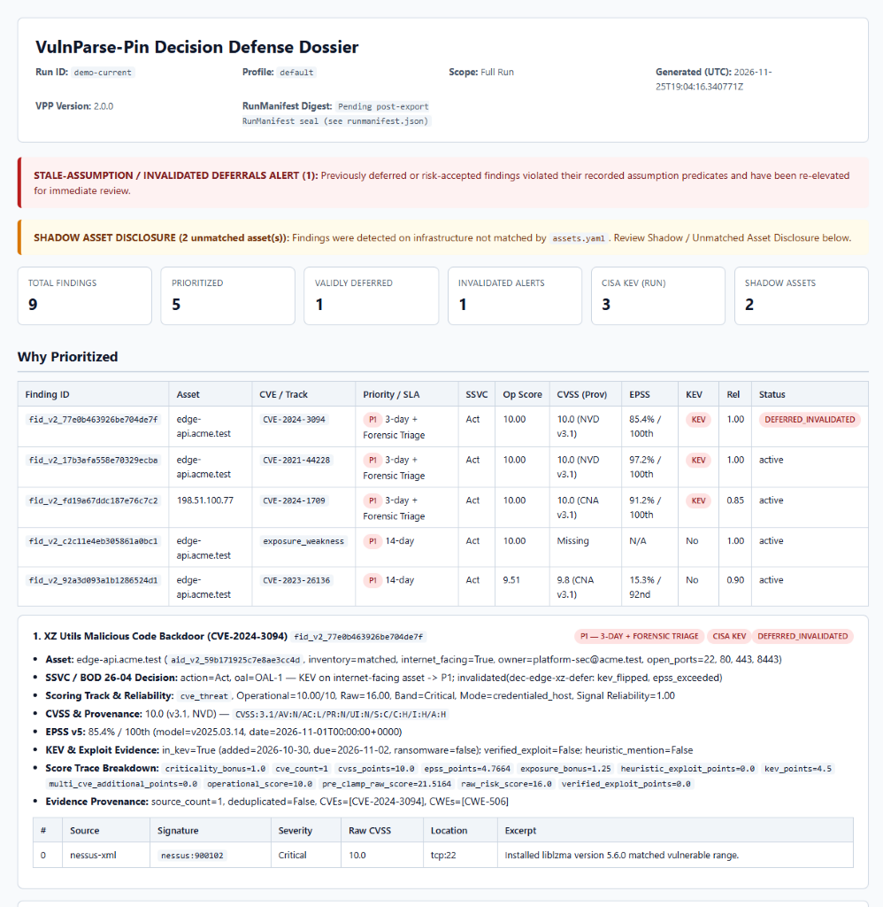
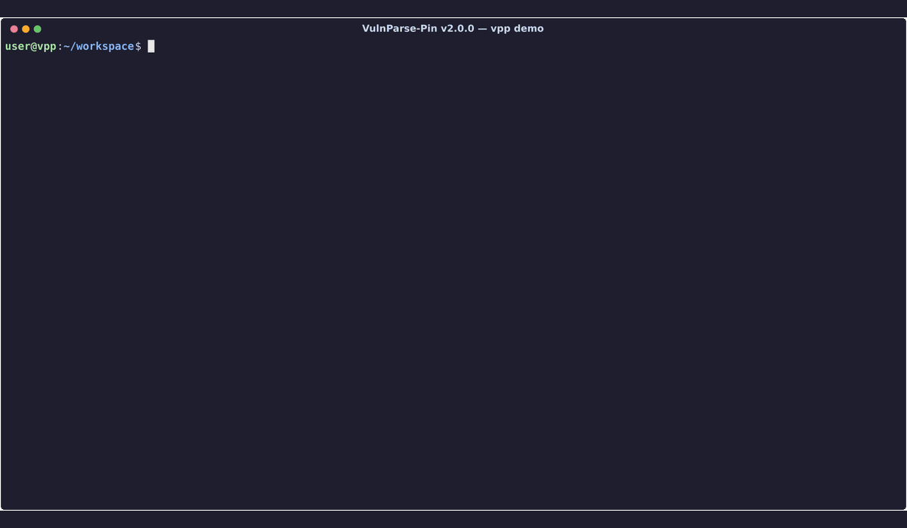

<!-- markdownlint-disable MD009 MD026 MD032 MD033 MD041 MD045 -->

<p align="center">
  
</p>

<h1 align="center">VulnParse‑Pin v2.0.0</h1>

<p align="center">
<strong>Turn 100,000 noisy Trivy, OpenVAS, Nuclei, and Nessus alerts into a defensible 20-item patch list—offline, in seconds.</strong>
</p>

<p align="center">
Normalize • Enrich • Prioritize • Defend • Diff
</p>

<p align="center">
<a href="https://docs.vulnparse-pin.com">Documentation</a> •
<a href="documentation/docs/Overview.md">Overview</a> •
<a href="documentation/docs/Features.md">Features</a> •
<a href="documentation/docs/Architecture.md">Architecture</a> •
<a href="documentation/docs/Getting%20Started%20In%205%20Minutes.md">Getting Started</a> •
<a href="CHANGELOG.md">Changelog</a> •
<a href="documentation/docs/Licensing.md">Licensing</a>
</p>


[](https://pepy.tech/projects/vulnparse-pin)

> **License Forward Cut (`v2.0.0+`):** VulnParse-Pin `v2.0.0` and later are licensed under **Apache-2.0** with zero copyleft Python runtime dependencies. Historical releases `v1.0.0–v1.2.2` remain licensed under `AGPL-3.0-or-later`.

<p align="center">
  
</p>
<p align="center">
  <em>Self-contained offline <strong>Decision Defense Dossier</strong> (<code>dossier.html</code>) — CISA KEV + EPSS v5 + CVSS provenance, stale-deferral invalidation alerts, shadow-asset disclosure, and SHA-256 <code>RunManifest</code> chain with zero external CDNs.</em>
</p>

---

## Try It Offline in 60 Seconds

```bash
pipx install "vulnparse-pin[ui]" && vpp demo
```

*(Headless / CI installation without Textual TUI dependencies: `pipx install vulnparse-pin` or `pip install vulnparse-pin`, then run `vpp demo --no-ui`.)*

<p align="center">
  
</p>

`vpp demo` launches **100% offline in under 2 seconds** against a bundled multi-scanner sample pack (Nessus XML, Trivy SARIF, Nuclei JSONL, Semgrep SARIF, Nmap XML, pattern `assets.yaml`, `decisions.yaml`, and miniature EPSS v5 / KEV / NVD / GHSA snapshots):

- Deduplicates cross-scanner detections into a `.vpp-demo.db` DuckDB workspace (`aid_v2_` / `fid_v2_`)
- Scores both **CVE Threat** (`Track A`) and **Non-CVE Exposure & Weakness** (`Track B`) under `--profile bod-26-04`
- Flags **Unmatched Shadow Assets** and **Invalidated Deferrals** via `DiffEngine`
- Exports a self-contained **HTML + Markdown Decision Defense Dossier**, **Client Executive Roadmap**, and **RunManifest** (`vpp_demo_output/`)
- Opens the interactive **`vpp ui`** terminal workspace (filter P1/Exposure/KEV/Shadow via `1`/`t`/`k`/`u`, inspect live `score_trace`, press `e` to export dossiers, or `f` to record a deferral)

*(Demo screencast: [`documentation/img/vpp-demo.gif`](documentation/img/vpp-demo.gif) • VHS tape: [`documentation/demo/vpp-demo.tape`](documentation/demo/vpp-demo.tape).)*

---

## Why VulnParse-Pin Exists

Vulnerability scanners answer: *"What alerts fired across my hosts, images, and repos?"*
They do not answer: **"What should we patch in 3 days vs. 14 days vs. 60 days, which deferred waivers just went stale, and how do we prove it to auditors?"**

| Traditional Scanners & Spreadsheets | VulnParse-Pin v2.0.0 (`vpp`) |
| --- | --- |
| CVSS severity sorting & alert overload | Dual-track scoring combining CISA KEV, EPSS v5 (raw + percentile), verified exploits, exposure, and signal reliability |
| Black-box risk numbers | Auditable `score_trace`, CVSS provenance (`NVD > CNA > GHSA > OSV > Scanner-Supplied > Missing`), and SHA-256 hash-chained `RunManifest` |
| Duplicate alerts across Nessus, Trivy, Nuclei | Canonical `aid_v2_` / `fid_v2_` deduplication preserving all raw `finding_evidence` in DuckDB `.vpp.db` |
| Stale risk-acceptance spreadsheets | `decisions.yaml` + `vpp diff --fail-on stale-assumption` alerts loudly when KEV, EPSS, exposure, CVSS, or expiry breaks a waiver |
| Static hosts invisible in CMDB | Pattern-based `assets.yaml` matching + loud **Shadow Asset** disclosure (`unmatched_shadow`) |
| Hours assembling client/auditor decks | One-command offline HTML & Markdown **Decision Defense Dossiers** and **Executive Roadmaps** |

---

## Key Capabilities in v2.0.0

- **Persistent DuckDB Local Workspace (`.vpp.db`)**: 12-table columnar workspace (`runs`, `assets`, `asset_aliases`, `findings`, `finding_evidence`, `finding_cves`, `enrichment_snapshots`, `aci_signals`, `scores`, `triage_decisions`, `diff_events`, `ledger_events`) with POSIX `0o600` creation permissions, symlink rejection, and parameterized paged queries.
- **Hardened Streaming Parsers**:
  - Streaming `lxml.etree.iterparse` XML parsers (`nessus-xml`, `openvas-xml`, `qualys-xml`, `nmap-xml`) with XXE/DTD/Billion-Laughs fail-closed protection (`defusedxml` removed).
  - Streaming **SARIF 2.1.0** parser (chunked UTF-8 C `json.JSONDecoder.raw_decode` streaming + bounded `ijson` sniffing; `sarif-2.1.0` for Trivy, Grype, Semgrep, CodeQL) and line-streaming **Nuclei JSONL** (`nuclei-jsonl`), plus header-indexed Nessus/Qualys CSV (`--allow-large` up to 50 GiB).
- **EPSS v5 + CVSS v2/v3/v4 Provenance**:
  - Parses EPSS v5 `#model_version` / `score_date`, raw probability, and FIRST percentile into HMAC-signed `epss_cache.sqlite3`, with strictly monotonic piecewise scoring breakpoints.
  - Clean-room Apache-2.0 CVSS v2.0 / v3.x / v4.0 base-score calculator (zero LGPL `cvss` runtime dependency) enforcing deterministic precedence: `NVD > CNA > GHSA > OSV > Scanner-Supplied > Missing`.
  - Negation-aware exploit heuristic separation (no KEV/Exploit double-counting; `"not exploitable"` never triggers `"exploitdb"`), GHSA PURL package indexing, and optional offline OSV cache (`osv_cache.sqlite3`).
- **`--profile bod-26-04` (CISA BOD 26-04 / SSVC)**: First-class `Triage@2.0` pass projecting Exposure, Exploitation (`active`, `poc`, `none`), Automatable, Technical Impact, and Signal Reliability into SSVC actions (`Act`, `Attend`, `Track*`, `Track`) and SLA buckets (`3-day + Forensic Triage`, `14-day`, `60-day`, `Fix on Upgrade`).
- **Dual-Track `ACI@2.0` & Signal Reliability**: Track A (`cve_threat`) plus Track B (`exposure_weakness`) so non-CVE misconfigurations, exposed admin panels, and SAST weaknesses receive explainable scores weighted by scanner `detection_mode` (`credentialed_host` / `active_dast` `1.0`, `sca_container` `0.90`, `uncredentialed_banner` `0.85`, `static_sast` `0.55` with P1-cap guardrail).
- **Pattern `assets.yaml`, Canonical `aid_v2_` & Shadow Assets**: 5-tier precedence matching (`alias`/`asset_id` → exact IP/FQDN/URI/image → longest-prefix CIDR → `fnmatchcase` glob → `unmatched_shadow` alert) bridging network IPs, hostnames, URLs, and container images.
- **`vpp diff` & `decisions.yaml` Stale-Assumption Alerts**: Scan-over-scan `DiffEngine` tracking new high-risk findings, threat-intel escalations, verified remediations, shadow-asset deltas, and invalidated deferrals/acceptances (`--fail-on p1|p2|kev|stale-assumption|none`, exit code `2`).
- **Decision Defense Dossiers & Executive Client Roadmaps**: Self-contained offline Jinja2 HTML & Markdown templates (`autoescape`, `md_escape`, zero external CDNs, custom `--template-dir`) documenting *Why Prioritized*, *Why Deprioritized / Deferred*, *Invalidated Deferrals*, *Shadow Asset Disclosure*, and linked `RunManifest` digest.
- **Optional Textual TUI (`vpp ui`)**: Lazy-loaded terminal explorer backed by `.vpp.db` with KPI/Shadow/Invalidation badges, instant filters (`1–4`, `t`, `k`, `u`, `/`), live `score_trace` & evidence inspector, `d` diff view, `e`/`E` dossier export, and `f` interactive deferral modal (`vpp defer`).

---

## Core Workflows

### Wedge A — Consultants, vCISOs & MSSPs (Multi-Scanner Assessment → Client Dossier & Roadmap)

Combine infrastructure, container, DAST, and Nmap scans with client asset rules (`assets.yaml`) and recorded waivers (`decisions.yaml`) to produce auditable offline deliverables:

```bash
# 1. Ingest multi-scanner findings into an engagement DuckDB workspace
vpp scan nessus.xml trivy.sarif nuclei.jsonl \
  --nmap nmap.xml \
  --assets assets.yaml \
  --decisions decisions.yaml \
  --profile bod-26-04 \
  --db engagement.vpp.db \
  --output-dossier out/dossier \
  --output-runmanifest out/runmanifest.json

# 2. Export a client-ready Executive Remediation Roadmap (HTML + Markdown)
vpp export --db engagement.vpp.db --format roadmap-html --output out/executive_roadmap.html
vpp export --db engagement.vpp.db --format roadmap-md --output out/executive_roadmap.md

# 3. Compare re-test scans to verify fixes and catch stale deferrals
vpp diff --db engagement.vpp.db --decisions decisions.yaml --output-md out/retest_velocity.md
```

### Wedge B — 3-Minute CI/CD Gate (Trivy SARIF + `vpp diff`)

Drop VulnParse-Pin into GitHub Actions or GitLab CI behind Trivy to persist `.vpp.db` across runs, attach HTML Decision Defense Dossiers, post concise PR diff comments, and fail builds (`exit 2`) if any deferred CVE silently enters CISA KEV, spikes in EPSS, or changes exposure:

```bash
trivy fs . --scanners vuln,misconfig --format sarif --output trivy.sarif
vpp scan trivy.sarif --assets assets.yaml --decisions decisions.yaml \
  --profile bod-26-04 --db .vpp.db --output-dossier out/dossier
vpp diff --db .vpp.db --decisions decisions.yaml \
  --fail-on stale-assumption --output-pr-comment out/pr_comment.md
```

Ready-to-copy templates & runnable recipes:
- **GitHub Actions**: [`examples/ci/github-actions-trivy-vpp.yml`](examples/ci/github-actions-trivy-vpp.yml)
- **GitLab CI**: [`examples/ci/gitlab-ci-trivy-vpp.yml`](examples/ci/gitlab-ci-trivy-vpp.yml)
- **Configs, Workflows & Deployments**: [`examples/`](examples/README.md) (`assets.example.yaml`, `decisions.example.yaml`, MSSP / air-gapped / drift-check scripts, Dockerfile / Compose / Kubernetes / systemd)
- **End-to-End Recipes**: [`documentation/docs/Workflow Examples.md`](documentation/docs/Workflow%20Examples.md)

---

## Honest Reachability Boundary

VulnParse-Pin provides **Network & Operational Reachability**, combining:
- **`Nmap` open ports** (`NmapAdapterPass` port reconciliation onto canonical assets)
- **Declarative `assets.yaml` exposure** (internet-facing flags, CIDR/glob/alias rules, and unmatched Shadow Asset disclosure)
- **Attack Capability Inference (`ACI@2.0`)** (capability/chain evidence and active DAST vs. static SAST Signal Reliability weighting)
- **Planned Phase 2 VEX ingestion** (OpenVEX / CycloneDX VEX status and justification provenance)

VulnParse-Pin **does NOT** perform AST source-code call-graph reachability analysis or eBPF kernel/runtime execution tracing.

---

## v2.0 DuckDB Scale Benchmarks

VulnParse-Pin includes a reproducible multi-scanner scale benchmark harness in [`benchmarks/bench_scale.py`](benchmarks/bench_scale.py) covering mixed Nessus XML, Trivy SARIF 2.1.0, Nuclei JSONL, Semgrep SAST SARIF, Nmap XML, `assets.yaml`, and offline EPSS v5 / KEV / NVD / Exploit-DB snapshots across all four v2.0 stages (`iter_batches()` → `ingest_normalized_batches()` → `populate_enrichment_snapshots()` → `run_v2_duckdb_pipeline()` → `query_findings_page()` + `get_run_summary_counts()`).

```bash
python benchmarks/bench_scale.py --findings 500000 --findings 700000 --json-out bench_v2_results.json
```

> **Measured on `2026-11-24T14:34:55Z`:** Python `3.12.3`, `Linux-6.18.58.1-microsoft-standard-WSL2-x86_64-with-glibc2.39` (`32` CPUs), `--profile bod-26-04`, `batch_size=10000`. See [`documentation/docs/Benchmarks.md`](documentation/docs/Benchmarks.md) for historical `v1.x` baselines.

| Raw Findings | Unique Findings | Assets (Shadow) | Parse+Ingest (s) | Enrich (s) | Pipeline DAG (s) | UI+Summary (s) | Total (s) | Throughput (raw/s) | Peak RSS (MiB) | `.vpp.db` (MiB) |
| ---: | ---: | ---: | ---: | ---: | ---: | ---: | ---: | ---: | ---: | ---: |
| 500,000 | 335,758 | 1,170 (178) | 39.215 | 8.572 | 38.705 | 0.8695 | 87.362 | 5,723.3 | 2364.70 | 278.76 |
| 700,000 | 420,846 | 1,170 (178) | 162.117 | 6.631 | 41.830 | 0.9523 | 211.531 | 3,309.2 | 2633.21 | 351.26 |

---

## Installation

### Isolated CLI Install (`pipx`, Recommended)

```bash
# Full CLI + interactive Textual TUI
pipx install "vulnparse-pin[ui]"

# Minimal headless CLI (ideal for CI/CD runners)
pipx install vulnparse-pin
```

### Virtual Environment (`pip`)

```bash
python -m venv .venv
source .venv/bin/activate  # Windows PowerShell: .venv\Scripts\Activate.ps1
pip install "vulnparse-pin[ui]"
```

### From Source (Development & Benchmarks)

```bash
git clone https://github.com/QT-Ashley/VulnParse-Pin.git
cd VulnParse-Pin
pip install -e ".[dev,ui]"
```

Both `vpp` and `vulnparse-pin` entrypoints (plus `python -m vulnparse_pin`) are installed. Legacy flags (`vpp -f scan.nessus`, `vpp --demo`, `vpp --verify-runmanifest ...`) remain supported via a transparent compatibility shim.

See [`documentation/docs/Installation.md`](documentation/docs/Installation.md), [`documentation/docs/Deployment%20Options.md`](documentation/docs/Deployment%20Options.md), and [`documentation/docs/Getting%20Started%20In%205%20Minutes.md`](documentation/docs/Getting%20Started%20In%205%20Minutes.md) for full options (including `pipx`/`uv tool`, Docker/Compose, Kubernetes `CronJob`, `systemd`, and air-gapped wheelhouses).

---

## Feedback, Contributions & Roadmap

- Contributor workflow and guidelines: [`CONTRIBUTING.md`](CONTRIBUTING.md)
- Security vulnerability reporting policy: [`SECURITY.md`](SECURITY.md)
- Product roadmap (`v2.0.0` shipped & Phase 2 `v2.1+` plans): [`ROADMAP.md`](ROADMAP.md)
- Release history & upgrade notes: [`CHANGELOG.md`](CHANGELOG.md)

---

## Documentation

- [Docs Index](documentation/docs/index.md)
- [Overview](documentation/docs/Overview.md)
- [Getting Started In 5 Minutes](documentation/docs/Getting%20Started%20In%205%20Minutes.md)
- [Usage Guide](documentation/docs/Usage.md)
- [Workflow Examples](documentation/docs/Workflow%20Examples.md)
- [Deployment Options](documentation/docs/Deployment%20Options.md)
- [Runnable Examples](examples/README.md)
- [Upgrade and Migration](documentation/docs/Upgrade%20and%20Migration.md)
- [Output Interpretation](documentation/docs/Output%20Interpretation.md)
- [Architecture](documentation/docs/Architecture.md)
- [Pipeline System](documentation/docs/Pipeline%20System.md)
- [Scoring and Prioritization Deep Dive](documentation/docs/Scoring%20and%20Prioritization%20Deep%20Dive.md)
- [Attack Capability Inference (ACI)](documentation/docs/ACI%20Feature%20Explanation.md)
- [RunManifest Overview](documentation/docs/RunManifest.md)
- [Security Features](documentation/docs/Security%20Features.md)
- [Benchmarks](documentation/docs/Benchmarks.md)
- [Licensing](documentation/docs/Licensing.md)

---

## License

Starting with **v2.0.0**, VulnParse-Pin is licensed under the **Apache License, Version 2.0** (`Apache-2.0`). See [`LICENSE`](LICENSE) and [`NOTICE`](NOTICE) for complete terms and third-party attributions.

- `v2.0.0+`: `Apache-2.0` — permissive for internal security operations, MSSP/consulting engagements, CI/CD gates, commercial embedding, and hosted services.
- `v1.0.0–v1.2.2`: `AGPL-3.0-or-later` — historical releases remain under their original license.

For full licensing details and disclaimers, see [`documentation/docs/Licensing.md`](documentation/docs/Licensing.md).

## Disclaimers

VulnParse-Pin is provided *"as is"*, without warranties or conditions of any kind, as described in Sections 7 and 8 of the Apache License, Version 2.0. VulnParse-Pin assists with vulnerability intelligence and triage prioritization and should be used alongside validation and authorized security operations; users are responsible for verifying external scanner outputs, threat-intelligence feed terms, and remediation actions.
