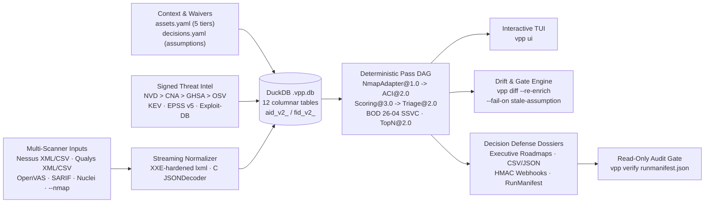

# VulnParse-Pin (`vpp`) Operator Tutorial

> **Audience & Scope:** An end-to-end engineering walkthrough of **VulnParse-Pin `v2.0.0` (`Apache-2.0`)**—from the 60-second offline demo to multi-scanner canonicalization, 5-tier `assets.yaml` matching, dual-track `Scoring@3.0` + `BOD 26-04` SSVC triage, interactive `vpp ui` investigation, assumption-bound `decisions.yaml` drift gates (`vpp diff --re-enrich`), Decision Defense Dossiers, read-only `vpp verify`, and air-gapped / `--read-only` container operations.
>
> Looking for a 60-second quickstart checklist first? Start with [Getting Started In 5 Minutes](Getting%20Started%20In%205%20Minutes.md), then come back here for the deeper mental model and hands-on labs.

---

## 0. The Core Mental Model

Traditional vulnerability pipelines stop at **finding enumeration**: *"Scanner A saw 4,200 CVEs; Scanner B saw 950 misconfigurations."* Operators still have to answer four hard questions manually:

1. **Deduplication & Asset Identity:** Which host in Nessus, container image in Trivy SARIF, web URL in Nuclei, and SAST finding in Semgrep refer to the **same canonical system** (`aid_v2_...`)?
2. **Defensible Priority (`Why P1 vs. P3?`):** How do we combine CISA KEV, EPSS v5 (raw probability + FIRST percentile), verified vs. negation-checked exploit mentions, Nmap open-port exposure, and **Signal Reliability** (credentialed scan vs. static SAST) without opaque black-box scores?
3. **Assumption-Drift Detection:** When a team defers a CVE today because *"it isn't in CISA KEV yet and EPSS < 2%"*, what catches that stale waiver **before** attackers exploit it next week?
4. **Cryptographic Proof for Auditors:** Can you hand an auditor or CISO an offline HTML dossier and prove via a read-only digest (`vpp verify`) that the inputs, threat-intel state, scores, and exported deliverables have not drifted or been tampered with?



---

## 1. Lab 1 — 60-Second Zero-Network Tour (`vpp demo`)

Before touching client scans or downloading external feeds, run the **100% offline** bundled demo in a scratch directory:

```bash
mkdir -p /tmp/vpp-tour && cd /tmp/vpp-tour

# Launches two seeded runs (demo-baseline -> demo-current), exports reports,
# and opens the Textual TUI against .vpp-demo.db:
vpp demo
```

Or run headlessly first so you can inspect CLI output, examine generated artifacts, and launch `vpp ui` afterward:

```bash
vpp demo --no-ui --profile bod-26-04 --output-dir ./vpp_demo_output --db ./.vpp-demo.db
```

### What `vpp demo` Demonstrates Immediately

- **Multi-Scanner Fusion (`5` formats):** Combines bundled `demo_baseline.nessus`, `demo.nessus`, `demo_trivy.sarif`, `demo_nuclei.jsonl`, `demo_semgrep.sarif`, and `--nmap demo_nmap.xml` alongside bundled `assets.yaml`, `decisions.yaml`, and miniature KEV / EPSS / NVD / GHSA / Exploit-DB snapshots.
- **Canonical Deduplication:** Produces `9` unified findings (`6` `cve_threat`, `3` `exposure_weakness`), collapsing overlapping detections across scanners under stable `fid_v2_...` IDs while keeping every raw snippet in `finding_evidence`.
- **Loud Risk Surfaces:**
  - **2 Unmatched Shadow Assets** (`198.51.100.77`, `198.51.100.88`) — scanned infrastructure missing from `assets.yaml`.
  - **1 Invalidated Deferral** (`CVE-2024-3094` on `203.0.113.10`) — deferred when `in_kev: false` and `max_epss: 0.02`, then automatically re-elevated (`DEFERRED_INVALIDATED` / `P1 — 3-day + Forensic Triage`) after KEV and EPSS flipped.

---

## 2. Lab 2 — Multi-Scanner Ingestion, 5-Tier `assets.yaml`, & `--nmap` Context

### Supported Formats

| Format | Parser ID | Key Production Hardening |
| :--- | :--- | :--- |
| Tenable Nessus `.nessus` (v2 XML) | `nessus-xml` | Streaming `lxml` + XXE fail-close, Nessus 10.7+ `<cvss4_*>`, `<exploit_framework_*>`, retroactive Plugin `19506` credentialed detection |
| Tenable Nessus / Tenable.sc / Tenable.io `.csv` | `nessus-csv` | Per-row `CVSS v4 > v3 > v2` priority fallback, `CVSS2#`/`CVSS3#`/`(...)` vector normalization, `Plugin Text` & `DNS`/`NetBIOS` aliases |
| Qualys VMDR XML | `qualys-xml` | Supports `<SCAN>` / `<SCAN_REPORT>`, `<ASSET_DATA_REPORT>` (with `<GLOSSARY>` lookup), and `<HOST_LIST_VM_DETECTION_OUTPUT>` |
| Qualys VMDR CSV | `qualys-csv` | Scans up to `25` rows past metadata preambles, prefers `CVSS3.1`/`CVSS3` over v2, handles plural `Results` |
| OpenVAS / Greenbone XML | `openvas-xml` | Streaming NVT/CVSS/CVE/CWE extraction + strict DTD/XXE rejection |
| SARIF `2.1.0` (Trivy, Grype, Semgrep, CodeQL) | `sarif-2.1.0` | Chunked C `JSONDecoder.raw_decode` streaming, SAST vs. SCA detection mode inference, PURL extraction |
| Nuclei JSONL | `nuclei-jsonl` | Line-streaming (up to `8 MiB`/line) capturing endpoints, tags, CVE/CWE, matched URLs |
| Nmap XML (`--nmap` vs positional) | `nmap-xml` | Open-port attack surface context via `--nmap` (`NmapAdapter@1.0`) |

> [!IMPORTANT]
> **`--nmap` vs. Positional `nmap.xml`:** Passing `nmap.xml` **with `--nmap`** enriches hosts discovered by Nessus/Trivy/Qualys/Nuclei with confirmed open ports for exposure scoring and SSVC tie-breaks (`NmapAdapter@1.0` — see [Nmap Context Deep Dive](Nmap%20Context%20Deep%20Dive.md)). Passing `nmap.xml` positionally (`vpp scan nmap.xml`) only creates informational port-exposure findings unless Nmap NSE vulnerability scripts were included.

### 5-Tier Canonical Asset Matching (`assets.yaml`)

Define your inventory rules once using [assets.example.yaml](../../examples/configs/assets.example.yaml) and [Configs](Configs.md):

1. **Tier 1 (`asset_id` / `aliases`):** Bridge disjoint scanner identifiers onto one asset — for example mapping IP `"203.0.113.10"`, FQDN `"api.example.org"`, URL `"https://api.example.org"`, and container `"ghcr.io/example/edge-api"` into one `aid_v2_edge_api_prod`.
2. **Tier 2 (Exact Match):** Exact `hostnames`, `uris`, `images`, or source `repos`.
3. **Tier 3 (Longest-Prefix CIDR):** Specific subnets like `10.20.40.0/24` (`critical` PCI CDE) automatically beat broader ranges like `10.20.0.0/16` (`medium` corp network).
4. **Tier 4 (`fnmatchcase` Globs):** Ephemeral hosts or images such as `*.staging.example.org` or `ghcr.io/example/staging-*`.
5. **Tier 5 (`unmatched_shadow`):** Unmatched assets are **never silently dropped** — they are labeled `unmatched_shadow` in DuckDB, flagged on stdout, filterable with `u` in `vpp ui`, and highlighted in a dedicated **Shadow Asset Disclosure** banner in dossiers.

```bash
vpp scan scans/nessus.nessus scans/trivy.sarif scans/nuclei.jsonl \
  --nmap scans/nmap.xml \
  --assets assets.yaml \
  --decisions decisions.yaml \
  --profile bod-26-04 \
  --db .vpp.db \
  --run-id sprint-42 \
  --output-dossier out/dossier \
  --output-md out/executive_roadmap.md \
  --output-runmanifest out/runmanifest.json
```

---

## 3. Lab 3 — Dual-Track `Scoring@3.0`, `ACI@2.0`, & `--profile bod-26-04`

VulnParse-Pin avoids conflating CVEs with non-CVE exposures and prevents unverified static findings from flooding `P1` queues (see [Scoring and Prioritization Deep Dive](Scoring%20and%20Prioritization%20Deep%20Dive.md) and [Attack Capability Inference (ACI)](ACI%20Feature%20Explanation.md)):

- **Two Explicit Tracks:**
  - **Track A (`cve_threat`):** Uses a clean-room Apache-2.0 **CVSS v2.0 / v3.x / v4.0** engine with deterministic provenance (`NVD > CNA > GHSA > OSV > Scanner-Supplied > Missing`), FIRST **EPSS v5** piecewise monotonic breakpoints + percentile tracking, CISA KEV status, and **negation-aware exploit separation** (`"not exploitable"` or `"no known exploit"` never earns exploit points).
  - **Track B (`exposure_weakness`):** Scores non-CVE weaknesses (exposed admin endpoints, missing TLS/headers, SAST CWE patterns) using `ACI@2.0` capability inference (`exposure`, `exploit`, `auth`, `persistence`, `lateral`) and asset exposure.
- **Signal Reliability Weighting & SAST Guardrail:**
  - `credentialed_host` / `active_dast`: `1.00`
  - `sca_container`: `0.90`
  - `uncredentialed_banner`: `0.85`
  - `static_sast`: `0.55` **+ `static_sast_p1_cap`** (prevents noisy unverified SAST alerts from jumping into `P1` without corroborating context).
- **CISA BOD 26-04 SSVC Triage (`--profile bod-26-04`):** Projects Exploitation (`active`, `poc`, `none`), Exposure, Automatable, Technical Impact, and Signal Reliability into SSVC actions (`Act`, `Attend`, `Track*`, `Track`) and remediation SLAs: `3-day + Forensic Triage`, `14-day`, `60-day`, or `Fix on Upgrade`.

Every score carries an auditable JSON `score_trace` broken down component-by-component inside `vpp ui`, `dossier.html`, and JSON outputs.

---

## 4. Lab 4 — Mastering the Interactive TUI Workbench (`vpp ui`)

Launch the Textual workbench against any DuckDB workspace (defaults to `.vpp.db`, automatically preferring the newest non-empty run if the latest run had zero findings):

```bash
vpp ui --db .vpp-demo.db --decisions decisions.yaml --output-dir ./exports
```

### Complete Keybinding Reference

| Key | Action | Behavior Highlights |
| :--- | :--- | :--- |
| `1` – `4` / `0` | Filter `P1`..`P4` / Clear | Pressing any filter key from the `Diff & Stale Assumptions` tab automatically switches back to `Findings` and focuses `#findings-table` |
| `t` | Cycle Track | Cycles `All` → `cve_threat` (`Track A`) → `exposure_weakness` (`Track B`) |
| `k` | Toggle KEV Only | Isolates CISA KEV matches |
| `u` | Toggle Shadow Assets | Isolates `unmatched_shadow` assets missing from `assets.yaml` |
| `/` | Live Search | Filters findings by CVE, title, asset, or finding ID; `Esc` clears search and returns to the table |
| `i` | Focus Inspector | Keyboard-only toggle into `#inspector-scroll` (`Up`/`Down`/`PageUp`/`PageDown` through `[Score Trace]` & `[Merged Scanner Evidence]`; `Esc` returns to table) |
| `[` / `]` | Paginate | Parameterized DuckDB keyset/offset paging (`sub-second` even at `500k+` findings) |
| `d` | Diff Tab | Switches between `Findings` and `Diff & Stale Assumptions` |
| `r` | Cycle Run | Cycles through historical runs stored in `.vpp.db` (showing run counts in the header/status bar) |
| `f` | Decision Modal | Opens `DeferralModal` pre-filled with the selected asset & CVE/rule ID; press **`Enter`** in Rationale → moves to Owner → **`Enter`** saves `decisions.yaml`, refreshes `triage_decisions`, updates `runs.decisions_sha256`, clears stale `runs.manifest_digest`, and appends a hash-chained ledger event |
| `e` / `E` | Export Dossier | Exports single-finding (`e`) or full-run (`E`) HTML + Markdown dossiers to `--output-dir` |
| `?` | Help Modal | Opens compact shortcut overlay (fits `80x24` terminals; blocks background hotkeys while open; `Esc` / `?` / `Enter` closes) |
| `q` | Quit | Exits cleanly |

---

## 5. Lab 5 — Assumption-Bound Deferrals (`vpp defer`) & Continuous Drift (`vpp diff --re-enrich`)

Instead of static *"ignore forever"* spreadsheets, [decisions.example.yaml](../../examples/configs/decisions.example.yaml) binds every `deferred`, `accepted`, or `mitigated` record to explicit **validity predicates**:

```bash
# Upsert a deferral via CLI and immediately re-evaluate the latest run in .vpp.db:
vpp defer \
  --asset "*203.0.113.10*" \
  --id CVE-2024-3094 \
  --status deferred \
  --rationale "Waiting on base image rebuild; mitigated by edge WAF." \
  --owner platform-sec@example.org \
  --expires 2027-06-01 \
  --in-kev false \
  --max-epss 0.02 \
  --decisions decisions.yaml \
  --db .vpp.db
```

You can now run scheduled threat-intel drift checks **without retaining or re-parsing raw scanner XML/SARIF files** (see [scheduled-kev-drift-check.sh](../../examples/workflows/scheduled-kev-drift-check.sh)):

```bash
# 1. Refresh threat-intel SQLite caches (or pass --years 2021-2026 for NVD history)
vpp intel sync --feed kev
vpp intel sync --feed epss
vpp intel sync --feed nvd --years 2021-2026

# 2. Re-enrich stored run CVEs non-destructively & fail CI/Cron on broken assumptions:
vpp diff --db .vpp.db --decisions decisions.yaml --re-enrich \
  --fail-on stale-assumption \
  --output-md out/drift_report.md \
  --output-pr-comment out/pr_comment.md \
  --output-json out/drift_report.json
```

If `CVE-2024-3094` enters CISA KEV or crosses `epss > 0.02` in your refreshed caches, `vpp diff --re-enrich` exits with code **`2`** (`STALE-ASSUMPTION` gate triggered), marks the finding `DEFERRED_INVALIDATED`, and itemizes the exact `violated_predicates` (`kev_flipped`, `epss_exceeded`, `expired`, etc.) without mutating frozen baseline snapshots.

---

## 6. Lab 6 — Decision Defense Dossiers, Roadmaps, & Read-Only `vpp verify`

1. **Dossier Seal Nuance (Single-Pass vs. Post-Export):**
   - Single-pass `vpp scan --output-dossier out/dossier --output-runmanifest out/runmanifest.json` writes `dossier.html` *before* hashing all deliverables into `runmanifest.json` (preventing circular SHA-256 self-reference), so the header displays `Pending post-export RunManifest seal (see runmanifest.json)`.
   - Run `vpp export` immediately afterward to embed the sealed **`sha256:...`** `RunManifest` digest directly inside `dossier.html`:
     ```bash
     vpp export --db .vpp.db --format dossier-html --output out/dossier.html
     vpp export --db .vpp.db --format roadmap-html --output out/executive_roadmap.html
     ```
2. **CSV Formula-Injection Defense:** `vpp export --format csv` automatically neutralizes `=`, `+`, `-`, `@`, `\t`, and `\r` formula cells unless both `--no-csv-sanitize` and `--confirm-unsafe-csv` are explicitly passed (`exit 2` otherwise).
3. **Zero-Write Cryptographic Verification (`vpp verify`):**
   ```bash
   vpp verify out/runmanifest.json
   ```
   Validates `RunManifest` v2 JSON schema, `verification.manifest_digest`, every `decision_ledger` SHA-256 hash-chain link (`prev_hash` → `entry_hash` → `chain_root`), and SHA-256 hashes of every listed artifact — **without creating log files or requiring write permissions** (safe on read-only mounts; see [RunManifest Overview](RunManifest.md)).

---

## 7. Lab 7 — Air-Gapped Enclaves, Signed Webhooks, & Hardened Containers

- **Air-Gapped HMAC Bundles ([airgapped-sync-and-scan.sh](../../examples/workflows/airgapped-sync-and-scan.sh)):** Set `VP_FEED_CACHE_HMAC_KEY` + `VP_SQLITE_HMAC_KEY` on connected staging (`vpp intel sync --feed all --portable`), verify via read-only `vpp intel status --portable --json`, transfer `./data/cache`, and run offline scans inside the enclave with **`--portable --enforce-root-read`**. Always pair `--enforce-root-read` with `--portable` when scanning inputs under `$PWD`; tampered SQLite, feed, or NVD sidecars fail closed (`exit 1`) before auto-quarantine or scoring (see [Security Features](Security%20Features.md)).
- **Signed Webhooks:** Passing `--webhook-endpoint https://... --webhook-oal-filter P1` emits canonical `vpp.topn.summary` JSON signed with `VP_WEBHOOK_HMAC_KEY` (`X-VPP-Signature: sha256=...`, `X-VPP-Timestamp`, `X-VPP-Nonce`), excludes validly suppressed findings while still alerting on `DEFERRED_INVALIDATED`, enforces HTTPS + no redirects + SSRF/DNS-rebinding checks, logs a `WEBHOOK_DELIVERY` ledger event, and fails closed if the signing key environment variable is missing.
- **Hardened Portable Container (`ghcr.io` / `Dockerfile`):**
  ```bash
  docker run --rm --read-only --cap-drop=ALL --security-opt=no-new-privileges:true \
    --tmpfs /tmp:rw,noexec,nosuid -v "$PWD:/work" -v "vpp-cache:/cache" \
    ghcr.io/qt-ashley/vulnparse-pin:2.0.0 demo --no-ui --output-dir /work/vpp_demo_output
  ```
  See [Deployment Options](Deployment%20Options.md) for Docker Compose stacks, Kubernetes `CronJob` drift gates, and hardened `systemd` units.

---

## Where to Go Next

- [Usage](Usage.md) — Complete subcommand, flag, and exit code reference
- [Workflow Examples](Workflow%20Examples.md) — Copy-pasteable MSSP, CI/CD, and air-gapped playbooks
- [Output Interpretation](Output%20Interpretation.md) — Reading Decision Defense Dossiers, Executive Roadmaps, and `RunManifest` chains
