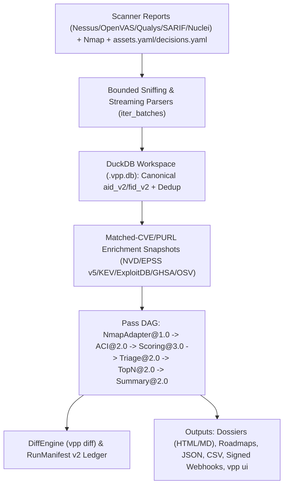

# VulnParse-Pin Overview

VulnParse-Pin (`vpp`) is an offline-capable vulnerability intelligence and decision-support engine for teams that need consistent, auditable, and explainable risk prioritization from multi-scanner output.

Starting with **v2.0.0** (`Apache-2.0`), it streams reports from infrastructure, container, DAST, and SAST scanners into a persistent **DuckDB workspace (`.vpp.db`)**, enriches matched CVEs and PURLs with threat intelligence, scores both CVE and non-CVE exposure findings (`Scoring@3.0` + `ACI@2.0`), evaluates CISA BOD 26-04 SSVC and deferral policies (`Triage@2.0`), detects scan-over-scan policy drift (`vpp diff`), and produces audit-ready **Decision Defense Dossiers**, **Executive Roadmaps**, an interactive **Textual TUI (`vpp ui`)**, and cryptographically verified **`RunManifest` v2** records.

## What it is

- A subcommand-first CLI (`vpp scan`, `demo`, `diff`, `ui`, `export`, `verify`, `defer`, `intel`) with an optional Textual terminal UI (`vulnparse-pin[ui]`)
- A persistent DuckDB-backed pipeline: stream/normalize → hydrate snapshots → `NmapAdapter@1.0` → `ACI@2.0` → `Scoring@3.0` → `Triage@2.0` → `TopN@2.0` → `Summary@2.0`
- A transparent, dual-track prioritization engine supporting both CVE threats (EPSS v5, KEV, CVSS v2/v3/v4) and non-CVE exposures weighted by Signal Reliability
- A high-volume streaming architecture benchmarked up to `700,000` multi-scanner findings with sub-second UI queries

## What problem it solves

Security and MSSP teams often face:

- Siloed scanner formats (Nessus, OpenVAS, Qualys, Trivy/Semgrep SARIF, Nuclei, Nmap) with duplicate findings across tools
- Manual triage bottlenecks, shadow assets missing from CMDBs, and alert fatigue from raw CVSS severity bins
- Fragmented enrichment across CISA KEV, FIRST EPSS v5, NVD, Exploit-DB, GHSA, and OSV
- Deferrals and risk acceptances that silently go stale when a CVE enters KEV, EPSS spikes, or an asset becomes internet-facing
- Opaque risk scores that cannot be defended to auditors, clients, or engineering leads

VulnParse-Pin standardizes findings under canonical `aid_v2_` / `fid_v2_` identity, preserves all merged scanner evidence in `.vpp.db`, catches stale deferral assumptions with `vpp diff --fail-on stale-assumption`, and produces self-contained Decision Defense Dossiers and verified `RunManifest` chains.

## Philosophy and Principles

- **Context-Driven Prioritization**: Combines exploitability (KEV, EPSS v5, verified exploits), asset context (`assets.yaml` CIDR/glob/alias rules and `--nmap` open ports), Signal Reliability (`detection_mode`), and organizational deferral policies (`decisions.yaml`).
- **Explainability**: Every finding retains a structured `score_trace`, SSVC decision path (`--profile bod-26-04` or `default`), and merged multi-scanner evidence viewable in `vpp ui` and Decision Defense Dossiers.
- **Permissive Open Source (`Apache-2.0`)**: Starting with **v2.0.0**, VulnParse-Pin is licensed under the **Apache License, Version 2.0** with zero copyleft Python runtime dependencies, enabling internal, embedded, CI/CD, and commercial MSSP workflows. (Legacy `v1.0.0–v1.2.2` releases remain under `AGPL-3.0-or-later`.)
- **Secure-by-Design**: Enforces fail-closed path/symlink checks (`PermFileHandler`), `0o600` DuckDB/SQLite permissions, XXE-hardened streaming `lxml`, HMAC/SHA-256 verified offline caches, CSV formula-injection sanitization, and read-only `vpp verify`.
- **Reproducibility & Auditability**: `RunManifest` v2 seals config hashes, input/output SHA-256 digests, and an append-only SHA-256 hash-chained decision ledger (`ledger_events`).

## Who it is for

- **Vulnerability management & SOC teams** running continuous triage and BOD 26-04 SLA tracking
- **MSSPs, pentest, and advisory teams** delivering branded client Executive Roadmaps and Decision Defense Dossiers
- **AppSec & DevSecOps teams** gating CI/CD pipelines on new P1s, KEV matches, and stale deferrals via `vpp diff`
- **Air-gapped & regulated operators** syncing verified local intel caches (`vpp intel sync`) and running 100% offline (`--offline`)

## Core capabilities

- **Supported Scanners**: Nessus XML/CSV, OpenVAS XML, Qualys XML/CSV, SARIF 2.1.0 (Trivy, Grype, Clair, Semgrep, CodeQL, Bandit), Nuclei JSONL, and Nmap XML context
- **Threat Intelligence**: CISA KEV, FIRST EPSS v5, NVD (CVSS v4.0/v3.x/v2.0), Exploit-DB, opt-in GHSA (`--ghsa`), and optional offline OSV (`--osv`)
- **DuckDB Pass DAG**: `NmapAdapter@1.0`, `ACI@2.0`, `Scoring@3.0`, `Triage@2.0` (`default` and `bod-26-04`), `TopN@2.0`, and `Summary@2.0`
- **Outputs & Workbench**: `.vpp.db` DuckDB workspace, HTML/MD Decision Defense Dossiers, HTML/MD Executive Roadmaps, PR Diff Comments, JSON (`namespace`/`flatten` overlays), CSV (`full`/`analyst`/`audit`), `RunManifest` v2, signed webhooks, and interactive `vpp ui`

## Architecture

See [Architecture](Architecture.md), [Pipeline System](Pipeline%20System.md), and [Detection and Parsing](Detection%20and%20Parsing.md) for deep technical details.

## Performance

VulnParse-Pin v2.0.0 is designed for high-volume multi-scanner workloads using streaming `lxml`, chunked `JSONDecoder.raw_decode` SARIF parsing, DuckDB `appender` bulk writes, and parameterized SQL queries. Reproducible 500k–700k scale measurements and historical `v1.x` baselines are documented in [Benchmarks](Benchmarks.md) and [Performance Optimizations](Performance%20Optimizations.md).

## Getting started

Read [Getting Started In 5 Minutes](Getting%20Started%20In%205%20Minutes.md) for a 2-second `vpp demo` walkthrough, or jump straight to:

- [Installation](Installation.md)
- [Usage](Usage.md)
- [Workflow Examples](Workflow%20Examples.md)
- [Deployment Options](Deployment%20Options.md)
- [Upgrade and Migration](Upgrade%20and%20Migration.md)
- [Licensing](Licensing.md)
- [Mission Statement](Mission%20Statement.md) & [Why VulnParse-Pin Exists](Why%20VulnParse-Pin%20Exists.md)
