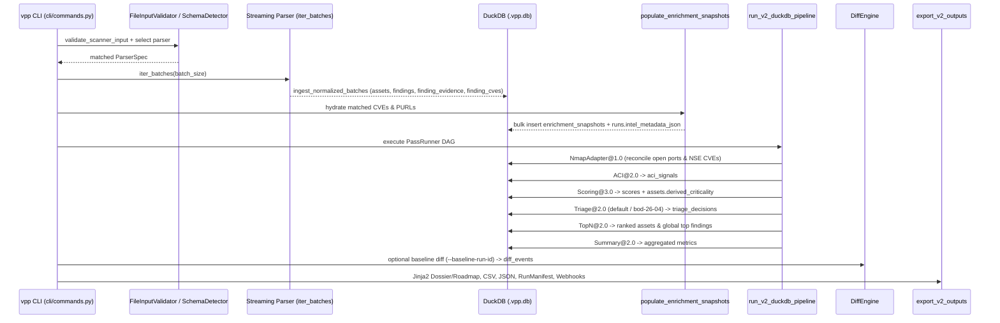

# Pipeline System

VulnParse-Pin v2.0.0 executes a streaming-to-DuckDB pipeline (`run_v2_duckdb_pipeline` in `src/vulnparse_pin/core/passes/__init__.py`) backed by `.vpp.db` persistence, run-scoped threat-intel snapshots, and versioned pass stages.

## v2.0 End-to-end flow

```mermaid
flowchart LR
    A[Scanner Inputs: XML / SARIF / JSONL / CSV] --> B[FileInputValidator + SchemaDetector]
    B --> C["Streaming Parsers (iter_batches)"]
    C --> D["enforce_batch_ingestion_gates -> ingest_normalized_batches (.vpp.db)"]
    D --> E["populate_enrichment_snapshots (KEV / EPSS v5 / NVD / GHSA / OSV / Exploit-DB)"]
    E --> F[run_v2_duckdb_pipeline]
    F --> G[NmapAdapter@1.0]
    G --> H[ACI@2.0]
    H --> I[Scoring@3.0]
    I --> J[Triage@2.0]
    J --> K[TopN@2.0]
    K --> L[Summary@2.0]
    L --> M["DiffEngine (vpp diff) & Ledger"]
    M --> N[Dossiers / Roadmaps / CSV / JSON / RunManifest / TUI]
```

## Runtime sequence (`vpp scan`)



## Pass contract and canonical v2.0 pass order

Pass abstractions live in `src/vulnparse_pin/core/classes/pass_classes.py`:

- `Pass` protocol defines `name`, `version`, `requires_passes`, and `run(ctx, scan) -> DerivedPassResult`.
- `PassRunner` validates dependency DAG ordering and executes passes sequentially.
- `DerivedContext` stores pass outputs keyed by `<Name>@<Version>`.

Canonical `run_v2_duckdb_pipeline()` order:

1. `nmap_adapter@1.0` (`NmapAdapterPass`, optional when `--nmap` / `--nmap-ctx` is provided)
2. `ACI@2.0` (`ACIV2Pass`)
3. `Scoring@3.0` (`ScoringV3Pass`)
4. `Triage@2.0` (`TriageDecisionPass`, supporting `default` and `bod-26-04` profiles)
5. `TopN@2.0` (`TopNV2Pass`)
6. `Summary@2.0` (`SummaryV2Pass`)

Each pass reads its upstream tables from `.vpp.db` via `ctx.services.db` and `ctx.services.run_id`, writes its normalized outputs to `.vpp.db`, and emits a `DerivedPassResult` summary for downstream reporting and `RunManifest` ledger sealing.

## Streaming ingestion and memory bounds

- **Chunked/streaming parsing:** Parsers implement `iter_batches(batch_size=...)` (`base_parser.py`) rather than loading entire DOMs or JSON trees into memory.
- **Ingestion quality gates:** `enforce_batch_ingestion_gates()` (`src/vulnparse_pin/app/normalization.py`) enforces `--strict-ingestion` / `--no-allow-degraded-input` and `--min-ingestion-confidence` per batch while streaming, recording rejections into `LedgerService`.
- **Columnar bulk writes:** `ingest_normalized_batches()` and `populate_enrichment_snapshots()` use DuckDB `TEMP` staging tables and `conn.appender(...)` (`append_rows`) inside transactions for bulk performance.

## Legacy v1.x in-memory compatibility path

For legacy callers using `ScanResult` directly in memory (`src/vulnparse_pin/app/bootstrap.py` and compatibility tests), `PassRunner` retains the v1.x sequence:

1. `nmap_adapter@1.0` (`NmapAdapterPass`)
2. `Scoring@2.0` (`ScoringPass` — sequential `< 100`, ThreadPool `100..19,999`, ProcessPool `>= 20,000` with ThreadPool fallback)
3. `ACI@1.0` (`AttackCapabilityInferencePass`)
4. `TopN@1.0` (`TopNPass`)
5. `Summary@1.0` (`SummaryPass`)

New v2.0 CLI commands (`vpp scan`, `vpp demo`, `vpp diff`, `vpp export`, `vpp defer`, `vpp ui`) all operate on `.vpp.db` and `run_v2_duckdb_pipeline()`.

## Data flow guarantees

- **Append-only evidence:** Cross-scanner deduplication merges findings in `findings` while preserving every raw observation in `finding_evidence` and every CVE in `finding_cves`.
- **Isolated derived stages:** Passes communicate via versioned `.vpp.db` tables and `DerivedPassResult` objects rather than ad-hoc mutation of parser payloads.
- **Deterministic ordering:** All SQL ranking and reconciliation queries use deterministic `ORDER BY` tie-breakers ending in `asset_id ASC` / `finding_id ASC`.

## Deep-dive references

- [Pass Phases](Pass%20Phases.md)
- [Identity Contract](Identity%20Contract.md)
- [Caching Deep Dive](Caching%20Deep%20Dive.md)
- [Runtime Policy Deep Dive](Runtime%20Policy%20Deep%20Dive.md)
- [Scoring and Prioritization Deep Dive](Scoring%20and%20Prioritization%20Deep%20Dive.md)
